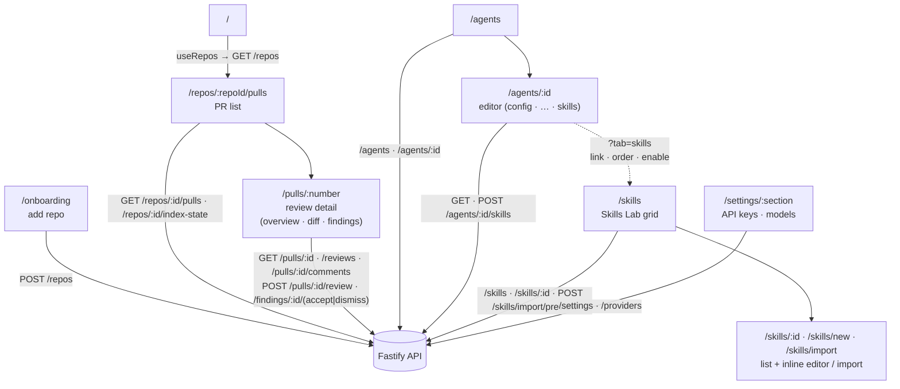

# `@devdigest/web` — the studio (Next.js 15)

The DevDigest UI: import repos, browse pull requests, run and read AI reviews,
and author agents. App Router + React Server/Client components, data via
**TanStack Query** hooks over the Fastify API. (This is the starter surface;
later milestones add the Skills, Memory, Eval, Blast/Brief, multi-agent, CI, and
dashboard screens.)

- **Stack:** Next.js 15 (App Router), React 19, TanStack Query, `next-intl`
  (messages in `messages/<locale>/*.json`), `recharts`, `mermaid`,
  `react-markdown`. UI primitives are vendored under `src/vendor/ui`
  (`@devdigest/ui`) and shared Zod contracts under `src/vendor/shared`
  (`@devdigest/shared`).
- **API base:** `NEXT_PUBLIC_API_BASE` (default `http://localhost:3001`), used by
  `src/lib/api.ts`. Every data hook lives in `src/lib/hooks/*`.
- **Run:** `pnpm dev` (`:3000`). **Test:** `pnpm test` (vitest + jsdom, fetch
  mocked — no API needed). **Typecheck:** `pnpm typecheck`.

## UI route map

Routes (`src/app/**/page.tsx`) and the API surface each leans on (via
`src/lib/hooks/*` → `src/lib/api.ts`):

The agent editor's Skills tab (`/agents/:id?tab=skills`) links workspace skills to the agent,
orders them (drag or Alt+↑/↓) and toggles them; order = order of the skill blocks in the system
prompt. The run trace's Prompt assembly lists each skill sent with its version and tokens.

## Intent card and trace (M3)

- **Overview.** `OverviewTab` loads `usePrIntent(prId)` (`GET /pulls/:id/intent`, key
  `reviewKeys.intent`) and, once the first load settles, renders `IntentCard` above the PR
  description. The card shows the quoted summary, in-scope and out-of-scope lists, risk-area chips
  and a footer (confidence badge with value, breaking badge, source chips, unresolved refs, model
  and cost). Low confidence adds a hint banner above the summary; with no intent it shows "Intent
  is derived when a review runs". All text is rendered as plain text and unresolved refs are never
  links. `FindingsTab` calls `usePrRunsRefresh().intent()` when runs settle, so the card updates
  after a review. Code: `src/app/repos/[repoId]/pulls/[number]/_components/IntentCard/`.
- **Trace drawer.** `RunTraceDrawer` shows an "Intent" configuration row (`category · level ·
  cached|fresh`) when the trace has `intent`, a "Specs read" row, and a "PR intent — derived
  (dynamic)" prompt block from `prompt_assembly.intent`. Legacy traces without intent render as
  before.
- **Settings → Models.** The `review_intent` feature ("PR Review · Intent") defaults to
  `openrouter` / `deepseek/deepseek-v4-flash` (`src/lib/feature-models.ts`, mirrored in the
  `platform.ts` contract).

Spec: [specs/M3-intent-layer.md](specs/M3-intent-layer.md).

## Smart Diff in Files changed (M3)

The Files changed tab groups files by role (core, tests, wiring, docs, boilerplate) from
`GET /pulls/:id/smart-diff` (`usePrSmartDiff`), with a Smart/Original toggle, and shows the latest
review findings inline. Details: [docs/smart-diff-files-changed.md](docs/smart-diff-files-changed.md).

Cross-cutting chrome lives in `src/components/app-shell` (nav, breadcrumbs,
`g`-then-key shortcuts). Pages are thin; feature logic sits in colocated
`_components/<Name>/` folders, each with its own `*.test.tsx`.

## Testing

Component/interaction tests (`*.test.tsx`) run under vitest + jsdom with `fetch`
mocked, so they need neither the API nor a browser. The real browser journeys
(client + API + seeded DB) are covered by the deterministic agent-browser suite
in [`../e2e`](../e2e/README.md) and the `e2e-web.yml` workflow. See
[`../TESTING.md`](../TESTING.md).
