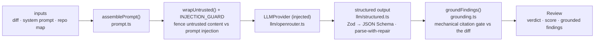

# `@devdigest/reviewer-core` — the review engine

Pure review logic: **diff → prompt → LLM → grounded findings**. No database,
GitHub, or filesystem; the only side effect is an LLM call through an **injected**
`LLMProvider`, which is what makes it mock-testable.

In the starter the **server** (`@devdigest/api`) is its only consumer — for local
reviews in the studio. (The CI runner that runs the same engine in GitHub Actions
is added back in the Export-to-CI milestone, M6.) The server wires it via a tsconfig
path alias (`@devdigest/reviewer-core` → `../reviewer-core/src`) and consumes the
TypeScript **source** directly (tsx in dev, vitest in tests). The package never
emits JS — its `build` is a type-check.

## Pipeline

The grounding step is the mandatory gate: a finding that doesn't cite a real line
in the diff is dropped, so the engine can't hallucinate locations. The score is
recomputed deterministically from the **surviving** findings, not trusted from the
model. `review/run.ts` orchestrates the run (single-pass by default).

The engine also accepts optional prompt slots the **later milestones** start
feeding it — `skills` (M2), `memory` (M7), `specs` (M5), `callers` — plus a
`reduce()`/map-reduce path and a `toReview()` CI payload helper used from M6.
Empty slots are omitted, so `assemblePrompt` simply leaves those sections out.

**Skills (M2)** are `PromptSkill { name, description, body }[]`, already filtered
to the agent's enabled links and in link order. They are rendered into the
**system** message: agent prompt → `## Skills (apply in order)` → injection guard
(always last). `renderSkillBlock` / `renderSkillsBlock` are exported so the
server can count tokens per skill for the run trace.
Spec: [specs/M2-skills-in-system-prompt.md](specs/M2-skills-in-system-prompt.md).

## PR intent (M3)

`PromptIntent` (`category`, `summary`, `inScope`, `outOfScope`, `breaking`, `confidenceLevel`,
`documented`, optional `riskAreas`) is the PR's intent, already **resolved by the caller**. The
engine does no I/O; it only renders it. `ReviewInput.intent` flows through `promptParts` into
`assemblePrompt`, and `renderIntentBlock(intent)` builds the section.

- **Placement.** In the user message after `## PR description` and before `## Relevant memory`.
  Without an intent the section is omitted and the messages are the same as before M3. In
  map-reduce every chunk gets the same block.
- **Layout.** Heading `## PR intent (derived from PR text — untrusted)`, a trusted rule line, a
  trusted confidence hint (low: "derived only from indirect signals"; medium: "treat as a hint";
  high: none), then the derived text in `<untrusted source="pr-intent">` (category and breaking,
  summary, `In scope`, `Out of scope`, `Risk areas`).
- **Out-of-scope rule.** The trusted line says the intent never reduces, waives or descopes a
  finding and that critical issues outside the stated scope are reported at full severity. The
  line sits outside the wrap, so the author's text cannot rewrite it.
- **Caps.** Wrapped body up to `MAX_INTENT_CHARS` (1500); at most 8 items per list, 200 chars each;
  at most 6 risk areas, 80 chars each.
- **Escaping.** `wrapUntrusted` neutralises the delimiter case-insensitively (`<untrusted`,
  `</UNTRUSTED`, whitespace variants).
- **Trace.** `assembly.intent` holds the rendered block, or `null`.

Code: [src/prompt.ts](src/prompt.ts#renderIntentBlock). Spec: [specs/M3-intent-in-prompt.md](specs/M3-intent-in-prompt.md).

## Public API

Exported from `src/index.ts`: `assemblePrompt` / `wrapUntrusted` / `renderSkillsBlock` / `renderSkillBlock` / `renderIntentBlock` / `MAX_INTENT_CHARS` / `PromptIntent` (prompt),
`groundFindings` / `groundingSummary` (grounding), `toJsonSchema` / `extractJson`
/ `parseWithRepair` (structured output), plus the `run` entrypoint and
`reduce`. Contracts (`Review`, `Finding`, `Verdict`, …) come from
`@devdigest/shared`.

## Testing

`npm test` (vitest) — hermetic units with a stubbed `LLMProvider`: prompt
assembly, the grounding gate, `toReview` selection, and a full `run`. No keys,
no network. `npm run typecheck` doubles as the build. See
[`../TESTING.md`](../TESTING.md).
