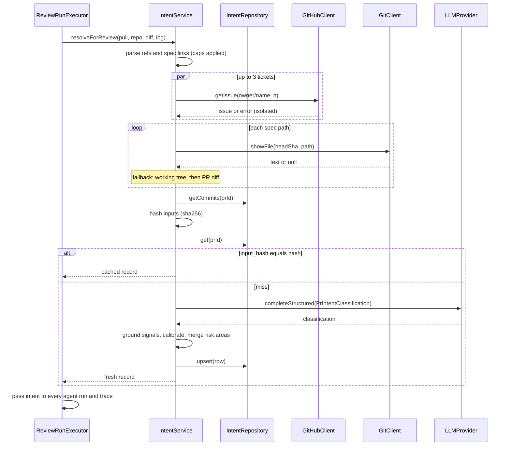

# Intent layer (M3)

How the server derives a pull request's intent before a review and hands it to the reviewer. Spec: [../specs/M3-intent-layer.md](../specs/M3-intent-layer.md).

The intent layer is a shared pre-step of a review run. Code collects the PR's own text, linked same-repo issues and linked spec files. One cheap model call (feature model `review_intent`) classifies them. Code then grounds the model's signals, computes the confidence and stores the result in `pr_intent`. The reviewer receives the stored record as an untrusted-wrapped `## PR intent` block ([reviewer-core README](../../reviewer-core/README.md#pr-intent-m3)).

Code lives in `src/modules/intent/`:

| File | Role |
|---|---|
| [domain.ts](../src/modules/intent/domain.ts) | Pure rules: ref and link parsing, classifier schema and messages, grounding, confidence, risk areas |
| [service.ts](../src/modules/intent/service.ts) | `IntentService.resolveForReview` (review pre-step) and `IntentService.get` (route) |
| [ports.ts](../src/modules/intent/ports.ts) | Store, log and dependency ports of the service |
| [repository.ts](../src/modules/intent/repository.ts) | Drizzle access to `pr_intent` (single owner of the table) |
| [routes.ts](../src/modules/intent/routes.ts) | `GET /pulls/:id/intent` |

The container builds the service in [container.ts](../src/platform/container.ts#intentService) with an explicit deps object (store, GitHub, `git.showFile`, `readContainedFile`, model resolver, LLM, timeout). The reviews module reaches it only through the `PrIntentResolver` port in [reviews/ports.ts](../src/modules/reviews/ports.ts).

## Data sources

Code collects every input. The model never names a file or a URL to read.

| Source | Origin | Cap |
|---|---|---|
| title | `pull_requests.title` | 300 chars |
| description | PR body with HTML comments stripped | 4000 chars sent |
| tickets | refs parsed from the body, fetched with `GitHubClient.getIssue`, this repo only | 3 tickets; title 200, body 4000 chars each |
| specs | paths parsed from the body and fetched ticket bodies | 3 files; 64 KB read, 8000 chars each, 16000 total |
| branch | `pull_requests.branch` | 200 chars |
| commits | first line of the newest commit messages | 20 commits, 200 chars each |
| changed paths | `diff.files[].path` | 50 paths |

The limits are in `INTENT_LIMITS` in [domain.ts](../src/modules/intent/domain.ts#INTENT_LIMITS).

**Ticket refs** (`parseTicketRefs`). Refs after a closing keyword (`close`, `fix`, `resolve` and their forms) come first, then plain mentions. Accepted forms are `#N`, `owner/repo#N` and a github.com issue URL. Refs to another repo become unresolved `other_repo`; refs past the third become `limit`; the PR's own number is skipped.

**Spec links** (`parseSpecLinks`, `normalizeSpecPath`). Accepted: markdown link targets, this repo's `github.com/.../blob/...` URLs and bare tokens ending in `.md .mdx .txt .rst .adoc`. Refused: `..` segments, absolute paths, NUL or backslash, a leading `-`, any `.git` segment (`unsafe_path`) and other extensions (`ext_not_allowed`). `#anchor` and `?query` are stripped. A blob URL is still read at the head sha. Other hosts are never fetched; they are recorded as `external_host` links (at most 10).

**Read order for one spec** (`readSpecs` in the service):

1. `git.showFile(repo, headSha, path)`: a blob at the PR head.
2. `readContainedFile(clonePath, path)`: the working tree, used when the head is not in the clone.
3. `addedFileFromDiff`: the `+` lines when the PR adds the file.

If none works the spec is unresolved `not_found`.

**Parse caps (ReDoS guard).** The link and ref regexes only see bounded text: `parseChars` (24000) is the hard cap inside `parseTicketRefs` and `parseSpecLinks`, and `bodyParseChars` (12000) is the slice of the PR body the service passes in, so body plus three ticket bodies stays under `parseChars`. The ref regexes also bound their owner and repo segments (`{1,100}`) and markdown link targets (`{1,300}`).

### `showFile`

`showFile` is a method of the `GitClient` port, implemented in [simple-git.ts](../src/adapters/git/simple-git.ts#showFile). It returns `null` on every refusal and never throws:

1. The sha must match `/^[0-9a-f]{7,40}$/i`.
2. The path must pass `safeBlobPath`.
3. `git ls-tree -z <sha> -- <path>` must show a regular blob (mode `100644` or `100755`; no symlink, tree or submodule) whose path equals the request. `-z` prints NUL-terminated, unquoted paths, so non-ASCII paths compare byte for byte.
4. `git cat-file -s` must be within `maxBytes` (default 64 KB).
5. `git cat-file blob` reads the content.

Arguments are always passed as an array.

## Call sequence

`ReviewRunExecutor` runs the pre-step once per run request, after `Loading PR diff` and before the agents. Its log is fanned out to every queued run.

The executor calls `resolveIntent` ([run-executor.ts](../src/modules/reviews/run-executor.ts#resolveIntent)). For each agent it passes `toPromptIntent(intent)` to `reviewPullRequest`. In map-reduce mode every chunk gets the same block. The trace gets `intent` (a snapshot), `prompt_assembly.intent` and `specs_read`.

## Confidence rule

Code computes confidence in `calibrateIntentConfidence`; the prompt does not ask the model for a calibrated value.

| Level | Condition | Numeric cap |
|---|---|---|
| high | description at least 120 chars and (one ticket resolved or one spec read) | 0.9 |
| medium | one documented source | 0.7 |
| low | only branch, commits and paths | 0.4 |

Adjustments:

- An unresolved ticket or spec ref (any reason except `limit`) moves the level down one step.
- Any external link lowers the numeric cap by 0.1.
- Category `unknown` forces `low`.
- Stored `confidence` is `min(model confidence, cap)`; `confidence_level` is the evidence level. `documented` is true when the description reaches 120 chars or a ticket or spec resolved.

## Caching

`pr_intent` has one row per PR (primary key `pr_id`). The cache key is `input_hash`, the sha256 of `canonicalIntentInput`: prompt version (`INTENT_PROMPT_VERSION`), provider, model, repo, PR number, title, description, ticket and spec contents, branch, commits, paths and code-derived risk areas. A hit skips the model call and logs `Intent cached …`. Any changed input, a different model or a prompt version bump is a miss and overwrites the row. Without a GitHub token the tickets stay unresolved, so the hash differs from the online case.

## Risk areas

`risk_areas` holds at most 6 entries, code first, then model. `mergeRiskAreas` dedupes by kind (and by label for `dependency`).

| Kind | Rule (`deriveRiskAreas`) |
|---|---|
| `dependency` | A `package.json` hunk adds a key in `dependencies`, `devDependencies`, `peerDependencies` or `optionalDependencies`; max 3. A version bump is not new. The key must pass the npm package-name filter (`NPM_NAME_RE`), so a sentence injected as a key never becomes a label. |
| `auth` | A changed path matches auth, login, session, oauth, jwt, token, permission, rbac or acl |
| `migration` | A path under `migrations/` or ending `.sql` |
| `config` | `.github/workflows/`, `Dockerfile*`, `docker-compose*` or a `.env` file; the path only, never the content |

The classifier may add up to 3 more (`origin: 'model'`, label up to 80 chars).

## Security and trust model

PR title, body, tickets and specs are author-controlled, so two hops carry injection risk (input to classifier, classifier output to reviewer).

- **Wrapping.** Each source is a separate `<untrusted source="…">` block ([`wrapUntrusted`](../src/modules/intent/domain.ts#wrapUntrusted)). The label is restricted to `[\w./#:-]`. The delimiter escape is case-insensitive and tolerates whitespace, so `<UNTRUSTED`, `< /untrusted` and similar variants are neutralised, not only `</untrusted>`.
- **Trusted instructions** end with a local injection guard in the classifier system prompt.
- **Bounded model output.** Every string and array in `PrIntentClassification` has a length or count bound.
- **Grounding.** `groundSignals` drops any signal that cites a source kind (or ticket or spec ref) that was not sent. A cited path is compared, never read.
- **File access.** Only paths parsed by code, extension allowlist, `showFile` checks above, `readContainedFile` for the working tree.
- **Outbound calls.** GitHub (issues) and the LLM only. Other URLs are recorded, not fetched.
- **Reviewer side.** The reviewer prompt states that intent never reduces, waives or descopes a finding.

## Live Log lines

All lines are prefixed `Intent` and appear in every run's Live Log and in the persisted `trace.log`.

| Event | Example |
|---|---|
| sources | `Intent: sources — title · description 1240 chars · 2 ticket ref(s) · 1 spec link(s) · 3 external link(s)` |
| no documentation | `Intent: no description/ticket/spec — deriving from branch, commits, paths; confidence capped at low` |
| ticket | `Intent: ticket #471 fetched ("…")`, `Intent: ticket #12 skipped — not_found` |
| spec | `Intent: spec specs/x.md read @a1b2c3d (4.1 KB)`, `… read from working tree …`, `… read from PR diff (new file) …`, `… skipped — ext_not_allowed`, `… truncated to 8000 chars` |
| external link | `Intent: warning — unresolved ref <url> (external_host, not fetched; lowers confidence)` |
| cache hit | `Intent cached (hash 3f9a1c2e, openrouter/deepseek/deepseek-v4-flash) — no model call` |
| model call | step `Classifying intent with <provider>/<model>` |
| grounding | `Intent: dropped N signal(s) citing a source that was not provided` |
| risk areas | `Intent: risk areas — Auth surface touched · (model) …` |
| result | `Intent: feat · confidence medium 0.62 (model 0.90) · breaking=no · $0.0004 · 812→96 tokens` |
| failure | `Intent failed — continuing review without intent: <message>` |

## Failure behavior

- An intent failure never fails the review. `resolveIntent` catches everything (no model key, the 20 s timeout `INTENT_TIMEOUT_MS`, invalid model output, DB error), logs the `Intent failed` error line into every run and returns `null`. Agents then run with the pre-M3 prompt and the trace has `intent: null`.
- A failed ticket fetch or an unreadable spec is isolated: the ref becomes unresolved, the level drops and the run goes on.
- If `Loading PR diff` fails, the intent step is never attempted.
- The classifier call uses `temperature: 0` and `maxRetries: 1`. Its cost is stored in `pr_intent.cost_usd`, separate from the agent runs' cost.

## Verifying it

- Hermetic (in `pnpm test`): `test/intent-service.test.ts` › "acceptance" — the classifier uses the
  resolved `review_intent` model; the request carries no hunks, added code or secrets from the diff
  (paths only); every spec linked from the description is sent with its content; Live Log lines show
  the prompt composition without code, PR text or secrets.
- Live (opt-in, real model): `pnpm intent:smoke <prId> [--fresh]` (`src/scripts/intent-smoke.ts`)
  runs the real service on a synced PR, records the exact request and prints PASS/FAIL for model,
  payload (outside the author's own documents), specs, log and the review-prompt block, plus the
  summary/scope for the one human check: does the card describe the PR's purpose? `--fresh` drops the
  cached row so the model is really called; exit code 1 on any FAIL.

## Storage and API

The `pr_intent` columns are defined in [reviews.ts](../src/db/schema/reviews.ts#prIntent) and added by migration [0017_groovy_ego.sql](../src/db/migrations/0017_groovy_ego.sql). `GET /pulls/:id/intent` returns `{ intent: PrIntentRecord | null }`: `null` until a review has run, 404 when the PR is outside the workspace. There is no recompute route.
