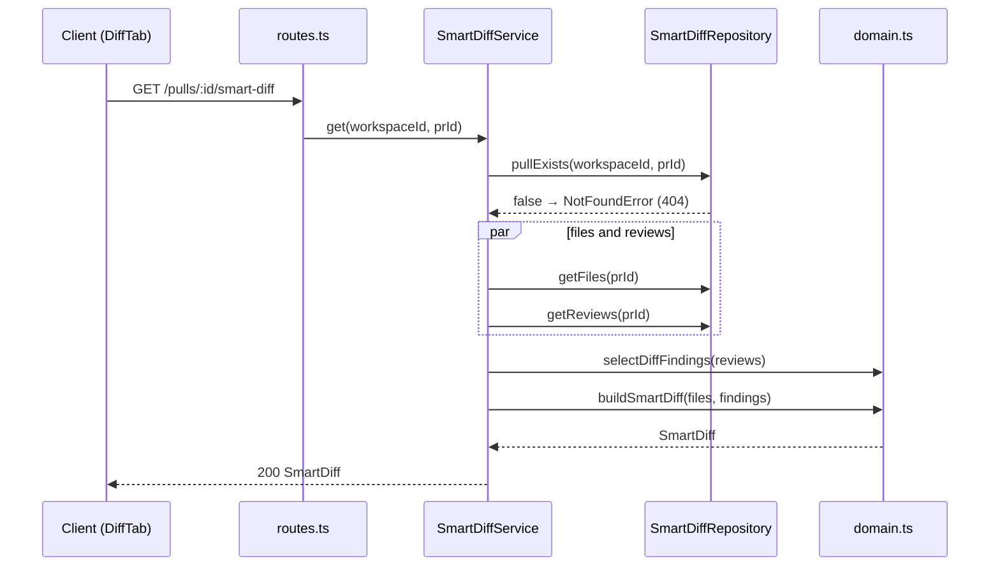

# Smart Diff (M3)

`GET /pulls/:id/smart-diff` groups a PR's changed files by reviewer role (core, tests, wiring, docs,
boilerplate) and reports which lines carry open review findings. It is deterministic and calls no
model, so it works before the first review run.

Code: [`modules/smart-diff/`](../src/modules/smart-diff/) — `routes.ts` → `service.ts` → `ports.ts` ←
`repository.ts`; pure rules in `domain.ts`, patterns in `constants.ts`. Wiring:
[`container.ts#smartDiffService`](../src/platform/container.ts) and
[`modules/index.ts`](../src/modules/index.ts).

## Why no model call

A file's role depends on its path alone. Path rules are free, repeatable (the same PR always groups
the same way), testable with a table, and need no API key. The response contract also has a
`split_suggestion`; the server fills only `total_lines` and returns `too_big: false` and
`proposed_splits: []`.

## Data flow

`pullExists` is the only workspace-scoped read; `getFiles` and `getReviews` run after it passed.
`getFiles` orders by path, so the server order within a group is alphabetical — the client re-sorts
to GitHub order.

## Response shape

- `groups` always holds all five roles in `SMART_DIFF_ROLE_ORDER`, empty ones included.
- Each file is `{ path, additions, deletions, finding_lines }`. `finding_lines` is the sorted, unique
  `start_line` of **non-dismissed** findings of that file.
- `selectDiffFindings` takes, per agent (`agent_id ?? review.id`), only the newest review with
  `kind: 'review'`. Summary reviews are ignored, so a re-run never duplicates findings.
- The client applies the same rule in
  [`DiffTab/helpers.ts#latestReviewFindings`](../../client/src/app/repos/[repoId]/pulls/[number]/_components/DiffTab/helpers.ts).
  Change both together.

## Classification rules

`classifyFile(path)` strips leading `./`, keeps the last 4096 characters
(`SMART_DIFF_MAX_PATH_CHARS`), and returns the role of the first matching rule in
`SMART_DIFF_RULES`. No match → `core`. Rules live in
[`constants.ts`](../src/modules/smart-diff/constants.ts).

| Order | Role | Matches |
|---|---|---|
| 1 | `boilerplate` | `dist/`, `build/`, `__snapshots__/`, `pnpm-lock.yaml`, `package-lock.json`, `yarn.lock`, `*.lock`, `*.snap`, `*.generated.*`, `*.min.js` |
| 2 | `tests` | `test/`, `tests/`, `__tests__/`, `e2e/`, `*.test.ts(x)` (covers `*.it.test.ts`), `*.spec.ts` |
| 3 | `wiring` | `.github/`, `.claude/`, `index.ts` / `index.js`, `*.config.*`, `tsconfig*.json`, `.eslintrc*`, `.env*`, `docker-compose*.yml` |
| 4 | `docs` | `docs/`, `*.md`, `README*`, `CHANGELOG*`, `LICENSE` |
| — | `core` | everything else |

Directory patterns match at any depth (`(?:^|\/)dir\/`). Matching is case-sensitive. Every pattern
is anchored and uses `[^/]*` only, so matching is linear on author-controlled paths; the table test
in [`test/smart-diff-domain.test.ts`](../test/smart-diff-domain.test.ts) includes a long-path time
budget.

### Precedence cases

| Path | Role | Why |
|---|---|---|
| `e2e/README.md` | `tests` | tests rule runs before docs |
| `__tests__/__snapshots__/x.snap` | `boilerplate` | boilerplate rule runs before tests |
| `.claude/skills/security/SKILL.md` | `wiring` | wiring rule runs before docs |

## Reuse from other modules (L08)

`domain.ts` is pure, but `reviews/` must not import another module's internals. When `reviews/`
needs `classifyFile` (for example to filter files before the prompt), move `classifyFile` and its
rules to `modules/_shared/` instead of importing `smart-diff/domain.ts` across modules.

## Tests

- [`test/smart-diff-domain.test.ts`](../test/smart-diff-domain.test.ts) — classifier table, ReDoS budget, `selectDiffFindings`, `buildSmartDiff`.
- [`test/smart-diff-service.test.ts`](../test/smart-diff-service.test.ts) — in-memory store: 404, no reviews, newest per agent.
- [`test/smart-diff.it.test.ts`](../test/smart-diff.it.test.ts) — real Postgres; run with `pnpm exec vitest run .it.test`.

The client side is described in
[client/docs/smart-diff-files-changed.md](../../client/docs/smart-diff-files-changed.md).
